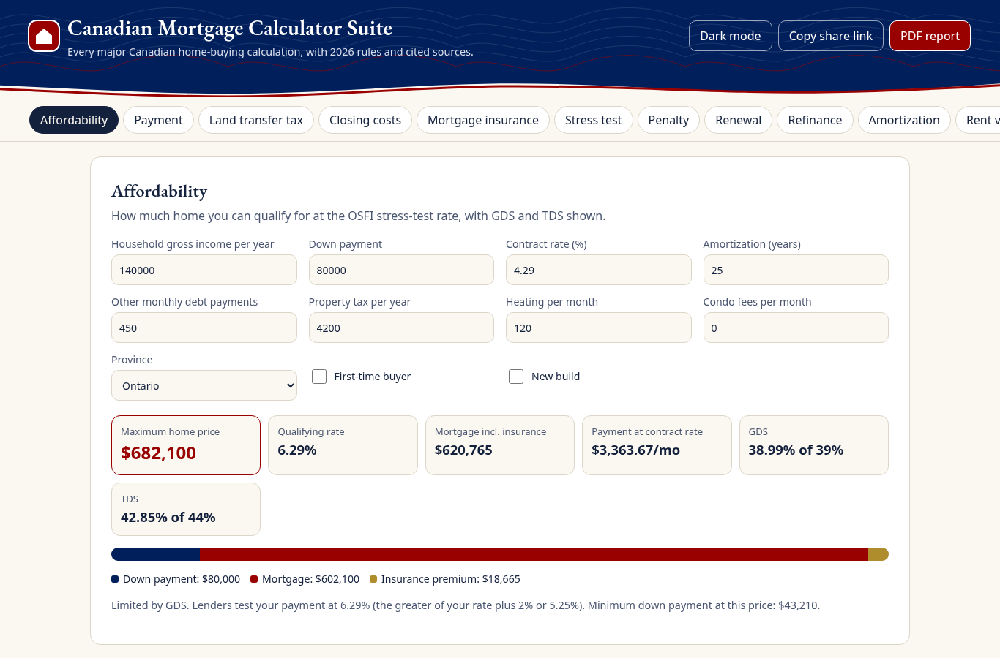
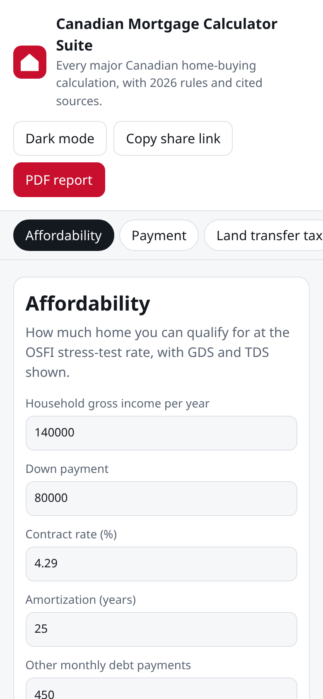

# Canadian Mortgage Calculator Suite

**Live:** https://alenzacodes.github.io/canadian-mortgage-suite/

Most Canadian mortgage calculators online either ignore the stress test, skip land transfer tax rebates, or quietly use US-style monthly compounding. This app puts fourteen calculators on one page and works through the rules the way a lender or lawyer would in October 2026, with a link to the source for each rule.

## What's in it

| Tab | What it works out |
|---|---|
| Affordability | Highest price you qualify for at the OSFI qualifying rate (contract + 2% or 5.25%, whichever is higher), against GDS 39% and TDS 44% |
| Payment | Monthly, semi-monthly, bi-weekly, weekly and accelerated payments, using semi-annual compounding as the Interest Act requires |
| Land transfer tax | All provinces and territories, Toronto's municipal tax including the 2026 luxury tiers, Montreal, and first-time buyer rebates |
| Closing costs | Legal, inspection, title insurance, PST on mortgage insurance, GST on new builds |
| Mortgage insurance | CMHC premium tiers, the 30-year surcharge, the $1.5M cap and provincial PST |
| Stress test | Pass or fail at the qualifying rate, with the ratio that binds |
| Penalty | Three months' interest vs. interest rate differential, including the posted-rate method the big banks use |
| Renewal and refinance | Payment change at renewal, and break-even on breaking early |
| Amortization | Full schedule with extra payments and lump sums, CSV export |
| Rent vs buy | Net worth after N years either way |
| FHSA and HBP | Down payment plan using both programs |
| GST/HST new home rebate | First-time buyer rebate on new homes |
| Compare | Up to three mortgages side by side |
| Sources | Every rule used, with the official source and an as-of date |

Every result can be shared as a link or printed as a PDF. Nothing is sent anywhere; it all runs in the browser.

On a phone:

## Running it

No build step. Clone the repo and open `index.html`, or serve the folder:

    python3 -m http.server 8000

then open http://localhost:8000/.

## Tests

    node test.js

129 checks cover the qualifying rate, compounding, payment frequencies, amortization schedules, land transfer tax brackets, CMHC premiums and penalties. Known figures (for example $639.81/month on $100,000 at 6% over 25 years) are used where they exist. The tests run on every push through GitHub Actions.

## Where the numbers come from

- Rules: OSFI (qualifying rate), CMHC (insurance premiums, GDS/TDS), FCAC (down payment minimums, penalties), the Interest Act (compounding), and each province's land transfer tax legislation. Citations with as-of dates are in `sources.js` and shown in the app.
- Market data in `data/`: Bank of Canada Valet (policy rate, posted and typical 5-year rates), Statistics Canada tables (household debt, debt service, new housing price index), CREA MLS® HPI, and posted rates from the Big Six banks. Private mortgage rates are an estimated range from published sources, not an official index. Full series IDs and URLs are in [data/SOURCES.md](data/SOURCES.md).

## Limits

- Rules and rates are as of October 2026. Lenders can apply stricter limits than the ones here.
- Land transfer tax for Nova Scotia uses the Halifax rate. Other Nova Scotia municipalities charge 0.5% to 1.5%.
- Territories charge land titles fees only, and the amounts here are estimates from published schedules.
- Private mortgage rates are an estimated range, not quotes.

## Layout

- `rules.js`: rate tables and thresholds
- `calc.js`: the formulas, usable in the browser and in Node
- `sources.js`: citations
- `app.js`, `index.html`, `style.css`: the interface
- `test.js`: unit tests

---

Educational only, not financial advice.

## Licence

MIT. Copyright 2026 John Khan.
